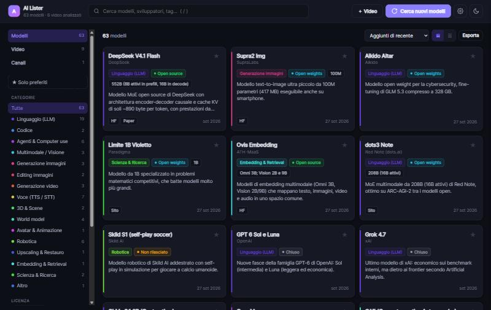
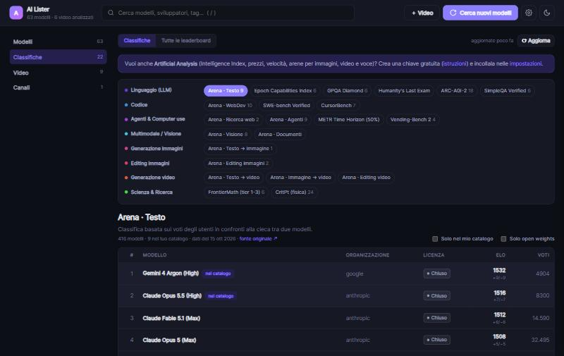

# AI Lister

**Catalogo locale dei modelli di intelligenza artificiale, aggiornato automaticamente analizzando i video dei canali YouTube che segui.**

*A local web app that keeps a searchable catalog of AI models up to date by having Claude analyze new videos from the YouTube channels you follow (descriptions, chapters and transcripts), and links each model to public leaderboards (Arena, Epoch AI, Artificial Analysis).*



Escono nuovi modelli ogni settimana: AI Lister li raccoglie in un unico posto, divisi per categoria, con licenza
(open source / open weights / chiuso), parametri, requisiti, link per scaricarli, paper e i video in cui sono stati presentati.

Premi **Cerca nuovi modelli**: l'app trova i video nuovi dei canali in lista, ne scarica descrizione, capitoli e
trascrizione e li fa analizzare a Claude tramite [Claude Code CLI](https://docs.claude.com/en/docs/claude-code/overview).
Claude estrae ogni modello presentato, lo classifica e, se vuoi, verifica i dati con ricerche web.

## Funzionalità

- **Catalogo ricercabile**: ricerca istantanea su nome, sviluppatore, descrizione e tag (tasto `/`), vista a schede o tabella, vari ordinamenti.
- **Filtri**: 17 categorie (LLM, immagini, video, voce, 3D, robotica…), tipo di licenza, disponibilità (locale, API, web app, demo…), preferiti.
- **Scheda dettagliata** per ogni modello: parametri (anche attivi per i MoE), contesto, architettura, dimensione su disco, VRAM,
  modalità di input/output, caratteristiche principali, link (Hugging Face, GitHub, paper, demo, sito…) e video in cui appare con link al minuto esatto.
- **Classifiche**: 22 leaderboard importate automaticamente da [Arena](https://arena.ai/leaderboard) ed [Epoch AI](https://epoch.ai/benchmarks)
  (più 7 da [Artificial Analysis](https://artificialanalysis.ai) con una chiave gratuita), collegate ai modelli del catalogo,
  e una directory di altre ~30 leaderboard da consultare. Vedi [Classifiche](#classifiche).
- **Aggiornamento incrementale**: i video già analizzati vengono saltati; se un modello riappare in un altro video la sua scheda viene arricchita, non duplicata.
- **Più canali**: aggiungi, disattiva o rimuovi canali dalla scheda *Canali*; con **＋ Video** analizzi anche singoli video di qualsiasi canale.
- **Correzioni manuali**: cambia categoria e licenza, aggiungi note personali, segna i preferiti, elimina voci.
- **Log in tempo reale** durante la ricerca, con possibilità di annullare; nuovi tentativi automatici sugli errori temporanei.
- **Esportazione** dell'intero catalogo in JSON.
- Tema chiaro/scuro, layout responsive.

## Requisiti

- **Windows** (testato su Windows 11; il codice è Python standard e gira anche su macOS/Linux avviando uvicorn a mano)
- **Python 3.11+** oppure [uv](https://docs.astral.sh/uv/)
- **Claude Code CLI** con un account Claude (abbonamento Pro/Max o API)

## Installazione e avvio

```bash
git clone https://github.com/mirkosampo/AI_Lister.git
cd AI_Lister
```

Su Windows basta un doppio clic su **`start.bat`**: la prima volta crea l'ambiente virtuale e installa le dipendenze,
poi avvia il server e apre <http://localhost:8765>.

Avvio manuale (qualsiasi sistema):

```bash
python -m venv .venv
.venv/Scripts/pip install -r requirements.txt      # macOS/Linux: .venv/bin/pip
.venv/Scripts/python -m uvicorn app.main:app --host 127.0.0.1 --port 8765
```

### Configurare Claude Code CLI

L'analisi usa `claude -p` (modalità non interattiva). Installa la CLI e fai il login una volta:

```bash
# Windows (PowerShell)
irm https://claude.ai/install.ps1 | iex
# macOS / Linux
curl -fsSL https://claude.ai/install.sh | bash

claude auth login
```

L'app cerca la CLI nel `PATH`, poi in `~/.local/bin` e infine tra quelle incluse nell'app desktop di Claude.
Puoi anche indicare un percorso preciso nelle impostazioni (⚙). Se la CLI non è pronta, la pagina mostra un avviso con il comando da eseguire.

#### Token di lunga durata (consigliato se usi anche l'app desktop di Claude)

La CLI e l'app desktop condividono lo stesso login OAuth. Quando il token scade, più processi possono provare a rinnovarlo
nello stesso istante e uno fallisce con:

```
Failed to refresh OAuth token: another Claude Code process is refreshing it or exited mid-refresh
```

AI Lister ritenta automaticamente (dopo 30, 60 e 120 secondi), ma la soluzione definitiva è un token dedicato che non ha bisogno di rinnovi:

```bash
claude setup-token
```

Copia `.env.example` in `.env` e incolla il token:

```
CLAUDE_CODE_OAUTH_TOKEN=...
```

Il file `.env` è escluso da git. In alternativa puoi impostare `CLAUDE_CODE_OAUTH_TOKEN` come variabile d'ambiente.
Nelle impostazioni dell'app trovi l'indicazione se il token di lunga durata è attivo.

## Come funziona

```
 Canali YouTube ──► yt-dlp: ultimi N video ──► video nuovi o in errore
                                                     │
              descrizione (con i link) + capitoli + trascrizione con [mm:ss]
                                                     │
                                                     ▼
          claude -p  ── prompt + JSON Schema + elenco modelli già in catalogo
                     ── (opzionale) WebSearch / WebFetch per verificare i dati
                                                     │
                                                     ▼
                     JSON validato ──► unione nel database SQLite ──► GUI
```

1. **Scoperta**: per ogni canale attivo `yt-dlp` legge gli ultimi N video (esclusi gli Short). Vengono analizzati solo quelli nuovi o finiti in errore, dal più vecchio al più recente.
2. **Raccolta**: descrizione (nei video di news contiene il link di ogni progetto), capitoli e trascrizione raggruppata in blocchi da 30 secondi con timestamp.
3. **Analisi**: Claude riceve tutto, più l'elenco dei modelli già presenti per riconoscere i doppioni, e risponde con JSON validato da uno schema.
   Le regole del prompt: niente sponsor né notizie che non riguardano modelli, nessun URL inventato, campi sconosciuti lasciati vuoti, testi descrittivi in italiano.
4. **Unione**: un modello già noto viene aggiornato (campi vuoti riempiti, link e tag uniti, descrizione sostituita solo se più ricca); una nuova versione (es. v2 dopo v1) diventa una voce separata.

Dettagli tecnici, schema del database e API: [docs/ARCHITETTURA.md](docs/ARCHITETTURA.md).

## Classificazione

| Licenza | Significato |
|---|---|
| **Open source** | pesi e codice rilasciati con licenza permissiva (MIT, Apache-2.0…) |
| **Open weights** | pesi scaricabili ma con licenza personalizzata/restrittiva, o codice non rilasciato |
| **Chiuso** | utilizzabile solo via API, app o prodotto |
| **Non rilasciato** | progetto o paper annunciato, codice e pesi non (ancora) disponibili |
| **Sconosciuto** | non determinabile |

Categorie: Linguaggio (LLM), Codice, Agenti & Computer use, Multimodale / Visione, Generazione immagini, Editing immagini,
Generazione video, Musica & Audio, Voce (TTS / STT), 3D & Scene, World model, Avatar & Animazione, Robotica,
Upscaling & Restauro, Embedding & Retrieval, Scienza & Ricerca, Altro. Si modificano in [`app/taxonomy.py`](app/taxonomy.py).

## Classifiche



La scheda **Classifiche** riunisce le principali leaderboard dei modelli di IA. Le classifiche vengono scaricate
all'avvio se hanno più di 24 ore (circa 15 secondi) oppure con il pulsante **Aggiorna**.

### Fonti importate

| Fonte | Classifiche | Accesso |
|---|---|---|
| [Arena](https://arena.ai/leaderboard) (ex LMArena) | Elo da voti umani alla cieca: Testo, WebDev, Visione, Documenti, Ricerca web, Agenti, Testo → immagine, Editing immagini, Testo → video, Immagine → video, Editing video | libero ([dataset su Hugging Face](https://huggingface.co/datasets/lmarena-ai/leaderboard-dataset), CC-BY 4.0) |
| [Epoch AI](https://epoch.ai/benchmarks) | Epoch Capabilities Index, GPQA Diamond, Humanity's Last Exam, ARC-AGI-2, SimpleQA Verified, FrontierMath, CritPt, SWE-bench Verified, CursorBench, METR Time Horizon, Vending-Bench 2 | libero ([archivio dati](https://epoch.ai/data), CC-BY 4.0) |
| [Artificial Analysis](https://artificialanalysis.ai) | Intelligence Index (con coding/math index, prezzo, velocità, latenza), Coding Index, arene Testo → immagine, Editing immagini, Sintesi vocale, Testo → video, Immagine → video | chiave API gratuita, 1000 richieste/giorno |

**Artificial Analysis**: crea una chiave gratuita seguendo la [documentazione](https://artificialanalysis.ai/documentation)
e incollala in ⚙ Impostazioni → *Chiave API Artificial Analysis*. La chiave viene salvata in `.env` (escluso da git)
e non viene mai inviata al browser. In alternativa scrivila tu in `.env`:

```
ARTIFICIAL_ANALYSIS_API_KEY=...
```

### Collegamento con il catalogo

Ogni voce delle classifiche viene confrontata con i modelli del catalogo tramite un nome normalizzato che ignora
maiuscole, separatori, date e varianti di configurazione, per cui `Claude Opus 5.5 (High)`, `claude-opus-5.5-high`
e `Claude Opus 5.5` sono lo stesso modello. Se non c'è corrispondenza esatta vengono collegati i tagli della stessa famiglia
(`MiMo V2.6` → `mimo-v2.6-pro`, `MiMo-V2.6-Flash`). Il collegamento viene rifatto dopo ogni ricerca e ogni aggiornamento.

Nell'app trovi le posizioni:
- sulle schede, con un badge 🏆 per la miglior posizione (tra le prime 20);
- nel dettaglio del modello, con la posizione in ogni classifica (un clic apre la classifica evidenziando il modello);
- nell'ordinamento *Miglior posizione in classifica*;
- nelle tabelle, dove i modelli del tuo catalogo sono evidenziati. Ci sono anche i filtri *Solo nel mio catalogo* e *Solo open weights*.

Molti modelli presentati nei video (progetti di ricerca, modelli vocali, robotica) non compaiono in nessuna classifica:
è normale che restino senza posizione.

### Altre leaderboard

Nella sotto-scheda **Tutte le leaderboard** c'è una directory curata, con descrizione e link, anche delle classifiche
che non offrono dati scaricabili: LiveBench, Scale SEAL, LLM Stats, Vellum, Kaggle Benchmarks, HELM,
Humanity's Last Exam, ARC Prize, SimpleBench, Vectara Hallucination, SWE-bench, Terminal-Bench, Aider Polyglot,
METR, BFCL, OSWorld, GAIA, OpenCompass, Open VLM, le arene di Artificial Analysis, TTS Arena, Open ASR, MTEB, OpenRouter Rankings.
L'elenco si modifica in [`app/leaderboards.py`](app/leaderboards.py).

## Impostazioni (icona ⚙)

| Opzione | Default | Note |
|---|---|---|
| Modello Claude | `sonnet` | alias (`sonnet`, `opus`, `fable`) o nome completo; i modelli più grandi classificano meglio ma sono più lenti |
| Effort | `medium` | `low` … `max` |
| Verifica con ricerche web | attiva | controlla licenza, parametri, repository e paper; un video di news con ~20 modelli richiede alcuni minuti |
| Video recenti per canale | 5 | aumentalo per recuperare lo storico di un canale |
| Lingua delle descrizioni | italiano | lingua di riassunto, descrizione e caratteristiche |
| Timeout per video | 1800 s | |
| Percorso Claude CLI | automatico | |
| Chiave API Artificial Analysis | — | facoltativa, salvata in `.env` |

Le impostazioni sono salvate in `data/settings.json`, le chiavi in `.env`.

## Dati e backup

Tutto resta sul tuo computer, nella cartella `data/` (esclusa da git):

| File | Contenuto |
|---|---|
| `data/ai_lister.db` | database SQLite: modelli, video, canali, note, preferiti e classifiche scaricate |
| `data/settings.json` | impostazioni |
| `data/claude_work/` | cartella di lavoro vuota in cui gira la CLI |

Per un backup copia `data/ai_lister.db` ad app chiusa: alla chiusura e dopo ogni video il journal SQLite viene consolidato
nel file principale. In alternativa usa **Esporta** per scaricare il catalogo in JSON.

## Risoluzione dei problemi

| Problema | Soluzione |
|---|---|
| Banner *"Claude CLI non autenticata"* | esegui `claude auth login` (o il comando indicato nel banner) e ricarica la pagina |
| `Failed to refresh OAuth token: another Claude Code process…` | errore temporaneo, l'app ritenta da sola; per eliminarlo usa il [token di lunga durata](#token-di-lunga-durata-consigliato-se-usi-anche-lapp-desktop-di-claude) |
| La ricerca si ferma con *"limite d'uso raggiunto"* | hai esaurito l'utilizzo del piano Claude: riprova più tardi, i video restano in coda |
| Un video resta *Errore* | il messaggio è visibile nella scheda *Video*; usa **Rianalizza**. I video in errore vengono ritentati alla ricerca successiva |
| Trascrizione non disponibile | l'analisi procede comunque con titolo, descrizione e capitoli |
| Porta 8765 occupata | chiudi l'altra istanza o cambia `PORT` in `start.bat` |
| yt-dlp non legge più YouTube | aggiorna le dipendenze: `.venv\Scripts\python -m pip install -U yt-dlp youtube-transcript-api` |
| Classifiche vuote o non aggiornate | premi **Aggiorna** nella scheda *Classifiche*; eventuali errori di una fonte compaiono in un avviso e non bloccano le altre |
| *"Artificial Analysis: chiave API non valida"* | ricontrolla la chiave nelle impostazioni (o rimuovila: le altre fonti funzionano comunque) |
| `No module named 'pyarrow'` | avvia da `start.bat`, che aggiorna le dipendenze, oppure `pip install -r requirements.txt` |

## Struttura del progetto

```
app/
  main.py        API FastAPI e file statici
  scanner.py     job di ricerca in background (log, nuovi tentativi, annullamento)
  youtube.py     elenco video, dettagli, trascrizioni (yt-dlp, youtube-transcript-api)
  analyzer.py    prompt, JSON Schema e invocazione di `claude -p`
  leaderboards.py  directory delle leaderboard e importazione da Arena, Epoch AI, Artificial Analysis
  db.py          SQLite e logica di unione dei modelli
  taxonomy.py    categorie, licenze, tipi di link
  config.py      percorsi e impostazioni
static/          interfaccia web (HTML/CSS/JS, nessuna build)
docs/            documentazione tecnica e screenshot
start.bat        avvio su Windows
```

## Privacy

- Il server ascolta solo su `127.0.0.1`: non è raggiungibile da altri dispositivi.
- Le connessioni esterne sono verso YouTube (metadati e trascrizioni), Claude tramite la CLI (con la verifica web attiva Claude visita anche le pagine dei progetti),
  Hugging Face ed Epoch AI per le classifiche e, solo se hai impostato la chiave, Artificial Analysis.
- Nessuna chiave è salvata nel codice: il login resta gestito dalla CLI, e i segreti facoltativi (token di lunga durata, chiave Artificial Analysis) stanno in `.env`, escluso da git.

## Crediti

Costruito con [FastAPI](https://fastapi.tiangolo.com/), [yt-dlp](https://github.com/yt-dlp/yt-dlp),
[youtube-transcript-api](https://github.com/jdepoix/youtube-transcript-api) e [Claude Code](https://docs.claude.com/en/docs/claude-code/overview).
Canale di partenza: [AI Search (@theAIsearch)](https://www.youtube.com/@theAIsearch).

Dati delle classifiche: [Arena](https://arena.ai) (CC-BY 4.0), [Epoch AI](https://epoch.ai) (CC-BY 4.0)
e [Artificial Analysis](https://artificialanalysis.ai), citati nell'app sotto ogni classifica come richiesto dalle rispettive licenze.
